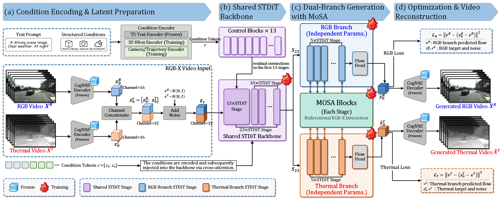

# DyadDrive: Controllable Generation of Paired RGB–Thermal Driving Videos under Asymmetric Observability

## Abstract

Paired RGB–Thermal driving video generation can provide controllable synthetic data for training and evaluating multimodal perception systems in autonomous driving. However, illumination and weather conditions affect RGB and thermal observations to different degrees, resulting in asymmetric observability of scene content. In addition, residual pixel-level misalignment may persist even after registration, making it difficult to learn cross-modal scene correspondence. We propose DyadDrive, a controllable diffusion framework that combines initial shared processing with independently parameterized RGB and thermal branches. Shared processing supports joint modeling, while the branches provide dedicated paths for distinct imaging responses. To coordinate scene content across branches, we introduce Moment-preserving Spatial Alignment (MoSA). Within each window, MoSA selects a guidance response according to its agreement with a shared-layer reference. This response guides a phase transformation of the receiving branch's own features, preserving their channel means and full channel covariance within each local update. We evaluate paired generation quality, scene correspondence, and visibility on DSERT-RoLL, supplemented by nuScenes experiments on RGB outputs from joint generation.

## Method Overview

## Paired Driving Videos

Each row compares the original paired video, its 3D bounding-box condition, and the generated paired video. RGB is on the left and thermal is on the right. Each sequence contains 9 frames at 10 FPS, with outputs generated at a resolution of 424 × 800.

| **Original RGB–Thermal** | **3D BBox Condition** | **Generated RGB–Thermal** |
| :---: | :---: | :---: |
|  |  |  |
|  |  |  |
|  |  |  |
|  |  |  |
|  |  |  |
|  |  |  |
|  |  |  |
|  |  |  |
|  |  |  |
|  |  |  |
|  |  |  |
|  |  |  |
|  |  |  |
|  |  |  |
|  |  |  |
|  |  |  |
|  |  |  |
|  |  |  |
|  |  |  |
|  |  |  |
|  |  |  |
|  |  |  |
|  |  |  |
|  |  |  |
|  |  |  |
|  |  |  |
|  |  |  |
|  |  |  |
|  |  |  |
|  |  |  |
